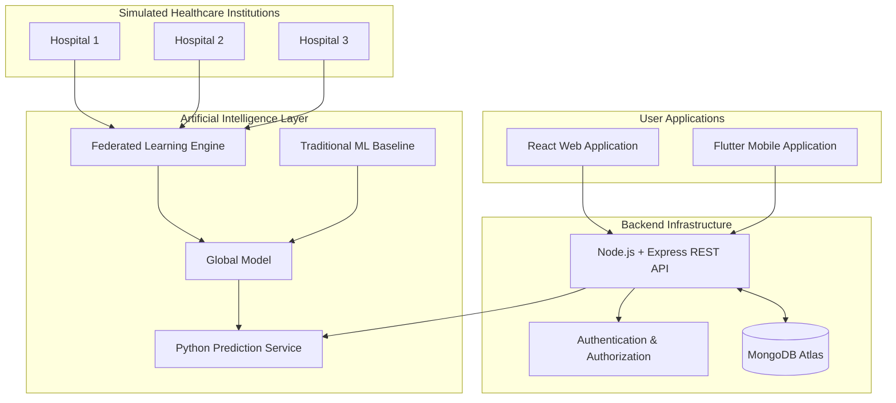
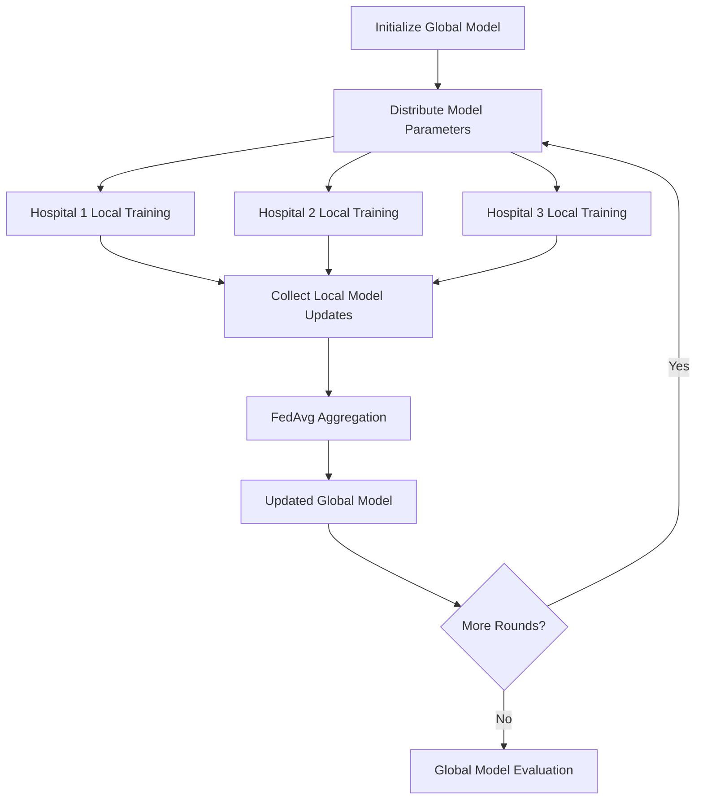
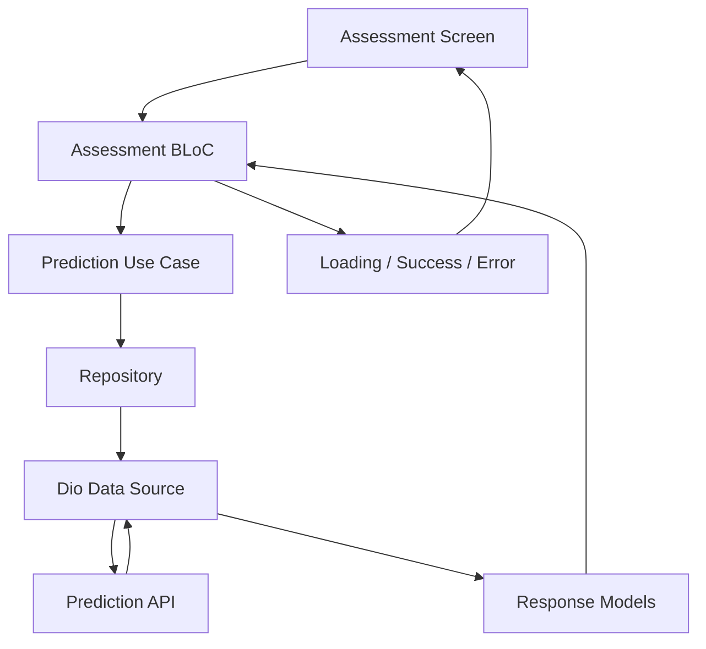

# 🏥 FedHealth
### Privacy-Aware Healthcare Intelligence Powered by Federated Learning

<p align="center">
  
  
  
  
</p>

<p align="center">
  <b>Bringing collaborative intelligence to healthcare without centralizing raw patient training data.</b>
</p>

---

## 📖 Table of Contents

- [Overview](#-overview)
- [The Problem](#-the-problem)
- [Our Solution](#-our-solution)
- [System Architecture](#-system-architecture)
- [Federated Learning Workflow](#-federated-learning-workflow)
- [Traditional vs Federated Learning](#-traditional-vs-federated-learning)
- [Dataset](#-dataset)
- [Technology Stack](#-technology-stack)
- [Platform Components](#-platform-components)
- [Security and Privacy](#-security-and-privacy)
- [Repository Structure](#-repository-structure)
- [Getting Started](#-getting-started)
- [API Integration](#-api-integration)
- [Limitations and Future Work](#-limitations-and-future-work)
- [Research Disclaimer](#-research-disclaimer)
- [Meet the Team](#-meet-the-team)
- [Acknowledgments](#-acknowledgments)

---

## 🌍 Overview

**FedHealth** is a healthcare research prototype that demonstrates how Artificial Intelligence and Federated Learning can support collaborative medical research while reducing the need to centralize sensitive patient training data.

The project simulates a distributed healthcare environment involving three independent hospitals. Each hospital trains a local machine learning model using its own dataset, while a central aggregation server coordinates the learning process using the **Federated Averaging (FedAvg)** algorithm.

Beyond the AI pipeline, FedHealth provides a complete software ecosystem consisting of:

- A Python-based AI and Federated Learning component.
- A Node.js and Express backend.
- A React-based web application.
- A Flutter mobile application.
- A dedicated UI/UX design.

The project also includes a traditional machine learning baseline to evaluate Federated Learning against centralized training.

**Our vision:** Explore how healthcare institutions can benefit from collaborative AI without requiring their raw training datasets to be pooled into one central location.

## 🎯 The Problem

Healthcare institutions generate valuable medical data, but collaboration between hospitals can be challenging because of:

- Patient data confidentiality.
- Institutional data ownership.
- Privacy and regulatory requirements.
- Distributed and isolated datasets.
- Limited data availability within individual institutions.

Traditional centralized machine learning typically requires collecting training data in one location.

This creates practical challenges for healthcare environments where sharing raw patient records may be restricted.

## 💡 Our Solution

FedHealth introduces a Federated Learning workflow across three simulated hospitals.

Instead of transferring raw training records to a central server:

1. Each hospital maintains its own local training dataset.
2. A local model is trained using the hospital's data.
3. Model parameters or updates are sent to the aggregation server.
4. The server combines local model parameters using FedAvg.
5. The aggregated global model can be evaluated and used for prediction.

This approach demonstrates collaborative model training while keeping the training datasets separated in the simulated environment.

## 🏗️ System Architecture

FedHealth consists of four main technical layers working together.

### High-Level Architecture



*The diagram illustrates the overall system design. Individual application workflows and model execution paths are implemented in their respective components.*

### Component Responsibilities

| Component | Responsibility |
|---|---|
| AI Layer | Data preprocessing, local training, FedAvg aggregation and model evaluation |
| Backend | Authentication, authorization, hospital management and API integration |
| Web Application | Browser-based healthcare assessment interface |
| Mobile Application | Patient assessment and prediction result presentation |
| Database | Application records and structured data management |
| UI/UX | User experience and interface design |

## 🧠 Federated Learning Workflow

The AI component demonstrates a simulated multi-hospital Federated Learning environment.

**Participating hospitals:** 3

**Aggregation algorithm:** Federated Averaging (FedAvg)

### How FedAvg Works



### Federated Averaging

FedAvg combines locally trained model parameters according to the amount of training data contributed by each participating hospital.

\[
w_{global}=\sum_{k=1}^{K}
\frac{n_k}{N}w_k
\]

Where:

- \(K\): Number of participating hospitals.
- \(n_k\): Number of training samples at hospital \(k\).
- \(N\): Total number of training samples.
- \(w_k\): Local model parameters.
- \(w_{global}\): Aggregated global model parameters.

This process allows multiple institutions to contribute to a shared model without requiring their raw training datasets to be transferred to the aggregation server.

## ⚖️ Traditional vs Federated Learning

A major part of this project is comparing two different machine learning training strategies.

### 1. Traditional Machine Learning

A centralized baseline is trained using the combined dataset.

### 2. Federated Learning

Local models are trained independently across the three simulated hospitals, followed by global aggregation using FedAvg.

### Comparison

| Aspect | Traditional ML | Federated Learning |
|---|---|---|
| Training | Centralized | Distributed |
| Data location | Combined training dataset | Separate hospital datasets |
| Local training | No | Yes |
| Aggregation | Not required | FedAvg |
| Raw data transfer | Required for centralized training | Not required between simulated hospitals |
| Evaluation | Baseline performance | Global model performance |

### Evaluation Objectives

The comparison aims to investigate:

- Predictive performance.
- Differences between centralized and distributed training.
- The impact of distributed data partitions.
- The potential of Federated Learning in healthcare research.

Actual evaluation metrics and numerical results should be reported from the experiment outputs rather than assumed.

## 📊 Dataset

### Haberman's Survival Dataset

The AI pilot uses the **Haberman's Survival Dataset**, which contains records from a study of patients who underwent surgery for breast cancer.

| Feature | Description |
|---|---|
| Age | Patient age at the time of operation |
| Year | Year of operation (1958–1970) |
| Nodes | Number of positive axillary lymph nodes |
| Survival | Survival outcome |

**Prediction target:**

- `1`: Survived five years or longer.
- `0`: Died within five years.

The dataset is used to demonstrate a binary classification and survival prediction workflow.

### Data Processing

The AI pipeline includes:

- Data preprocessing.
- Feature scaling.
- Dataset partitioning.
- Local hospital dataset preparation.
- Model training and evaluation.

The prepared dataset is distributed across three simulated hospitals.

## 🛠️ Technology Stack

### Artificial Intelligence & Machine Learning

| Technology | Purpose |
|---|---|
| Python | Core AI implementation |
| Pandas | Data manipulation |
| NumPy | Numerical operations |
| Scikit-learn | Machine learning |
| Pickle | Model serialization |
| Streamlit | AI demonstration interface |

### Backend Development

| Technology | Purpose |
|---|---|
| Node.js | JavaScript runtime |
| Express.js | REST API framework |
| MongoDB Atlas | Database |
| Mongoose | Database modeling |
| JWT | Authentication |
| bcryptjs | Password hashing |
| FastAPI | Python AI service |
| Swagger | API documentation |
| AES-256-GCM | Selected sensitive-field encryption |

### Web Development

| Technology | Purpose |
|---|---|
| React | Frontend framework |
| Vite | Development and build tooling |
| JavaScript | Application logic |
| CSS | Interface styling |
| React Router DOM | Navigation |
| Lucide React | Icons |

### Mobile Development

| Technology | Purpose |
|---|---|
| Flutter | Cross-platform application development |
| Dart | Programming language |
| flutter_bloc | State management |
| Dio | HTTP communication |
| GetIt | Dependency injection |
| Equatable | State comparison |
| flutter_svg | SVG assets |
| Skeletonizer | Loading presentation |

---

## 💻 Platform Components

### 1. Artificial Intelligence Module

The AI component is responsible for the machine learning pipeline.

**Implemented functionality:**

- Dataset preprocessing and scaling.
- Three simulated hospital datasets.
- Local machine learning training.
- Federated Averaging aggregation.
- Traditional centralized model baseline.
- Model evaluation and comparison.
- Global model export.
- Streamlit prediction demonstration.

**Main files:**

```text
AI/
├── 1_prepare_data.py
├── 2_train_federated.py
├── 3_app.py
├── haberman.csv
├── hospital_1.csv
├── hospital_2.csv
├── hospital_3.csv
└── federated_model.pkl
```

### 2. Backend Module

The backend provides the communication and application management layer.

**Main functionality:**

- User registration and login.
- JWT authentication.
- Role-based access control.
- Doctor and administrator permissions.
- Hospital management.
- Prediction request processing.
- Dashboard data retrieval.
- MongoDB integration.
- Selected sensitive-field encryption.
- Swagger API documentation.

**Architecture:**

```text
Backend/
├── Controllers/
├── Middleware/
├── Model/
├── Routes/
├── Utils/
├── app.js
├── swagger.js
├── package.json
└── .env.example
```

### 3. Web Application

The React application provides a browser-based interface for the healthcare assessment workflow.

**Implemented features include:**

- Welcome and authentication interfaces.
- Registration and login pages.
- Password recovery and reset pages.
- Doctor and administrator role selection.
- Hospital selection.
- Patient assessment form.
- Prediction result presentation.
- Arabic and English language switching.
- Application layout and quick settings.
- Responsive interface components.

The web prediction implementation includes a client-side prediction utility and bundled model weights.

### 4. Flutter Mobile Application

FedHealth also includes a mobile application prototype developed using Flutter.

**Implemented features:**

- Branded splash screen.
- Bottom navigation.
- Patient assessment form.
- Prediction API integration.
- BLoC-based state management.
- Loading, success and error states.
- Prediction response parsing.
- Shared UI components.
- Light theme and bundled assets.

The mobile assessment workflow follows a layered architecture:



The Research and Profile screens are currently UI placeholders.

---

## 🔐 Security and Privacy

Privacy is a central design consideration in FedHealth.

### Federated Learning Privacy

- Hospital training datasets remain locally separated in the simulated FL workflow.
- Local model parameters or updates are used for aggregation.
- Raw training records are not required to be pooled at the aggregation server.

### Backend Security

- JWT-based authentication.
- Role-based authorization.
- bcryptjs password hashing.
- AES-256-GCM encryption for selected sensitive fields.
- Environment-based configuration.
- Protected API routes.

**Security note:** Federated Learning alone does not guarantee complete protection against every privacy attack. Differential Privacy, Secure Aggregation and additional privacy-preserving mechanisms are not claimed as implemented features.

---

## 📁 Repository Structure

The project is organized into independent components:

```text
FedHealth/
│
├── AI/
│   ├── 1_prepare_data.py
│   ├── 2_train_federated.py
│   ├── 3_app.py
│   ├── haberman.csv
│   └── federated_model.pkl
│
├── Backend/
│   ├── Controllers/
│   ├── Middleware/
│   ├── Model/
│   ├── Routes/
│   ├── Utils/
│   └── app.js
│
├── Frontend/
│   ├── src/
│   │   ├── components/
│   │   ├── pages/
│   │   ├── services/
│   │   ├── data/
│   │   ├── i18n/
│   │   └── utils/
│   ├── package.json
│   └── vite.config.js
│
├── Flutter/
│   ├── lib/
│   ├── assets/
│   ├── android/
│   ├── ios/
│   └── pubspec.yaml
│
└── README.md
```

*This is the logical project structure. Individual repositories may maintain their own directory names.*

---

## 🚀 Getting Started

Each component can be configured and executed independently.

### Prerequisites

- Python 3.x
- Node.js and npm
- MongoDB database
- Flutter SDK
- Dart SDK compatible with the Flutter application
- Android Studio or an Android emulator
- Visual Studio Code or another suitable IDE

### 1. AI Module

Navigate to the AI directory:

```bash
cd AI
```

Install the required Python dependencies according to the project's requirements file.

Prepare the datasets:

```bash
python 1_prepare_data.py
```

Run the Federated Learning training and evaluation:

```bash
python 2_train_federated.py
```

Launch the demonstration application:

```bash
streamlit run 3_app.py
```

### 2. Backend

Navigate to the backend directory:

```bash
cd Backend
npm install
```

Configure the required environment variables in `.env`:

```env
PORT=3000
MONGO_URI=your_mongodb_connection_string
JWT_SECRET=your_secure_jwt_secret
AI_SERVICE_URL=http://127.0.0.1:8002
PREDICTION_ENCRYPTION_KEY=your_64_character_hex_key
```

Start the backend:

```bash
npm start
```

Open Swagger documentation:

```text
http://localhost:3000/api-docs
```

### 3. React Web Application

Navigate to the frontend directory:

```bash
cd Frontend
npm install
```

Configure the application according to `.env.example`.

Start the development server:

```bash
npm run dev
```

### 4. Flutter Mobile Application

Navigate to the Flutter directory:

```bash
cd Flutter
flutter pub get
flutter devices
flutter run
```

Run tests:

```bash
flutter test
```

Run static analysis:

```bash
flutter analyze
```

**Configuration note:** Actual folder names, environment variables, service ports and API paths should be verified against the corresponding component repositories before deployment. The AI service and frontend prediction paths must be configured consistently with the backend and model artifacts.

---

## 🔮 Limitations and Future Work

FedHealth is a research and engineering prototype. Several areas can be extended in future development.

| Area | Potential Improvement |
|---|---|
| Federated Learning | Test additional aggregation algorithms such as FedProx |
| Data Distribution | Evaluate different Non-IID data distributions |
| Privacy | Investigate Differential Privacy and Secure Aggregation |
| AI Evaluation | Expand experiments and compare additional evaluation metrics |
| Backend | Automated testing, monitoring and audit logging |
| Web | Complete backend integration and strengthen model consistency |
| Flutter | Implement Research and Profile features |
| Security | Production-grade key management and deployment security |
| Testing | Expand integration, API and widget test coverage |
| Deployment | Containerization and CI/CD improvements |

## ⚠️ Research Disclaimer

FedHealth is an educational and research-oriented prototype.

The Haberman dataset is used for demonstrating machine learning and Federated Learning concepts.

**Predictions are experimental outputs and must not be used for medical diagnosis, treatment decisions or clinical decision support.**

The application is not a certified medical device and has not been validated for clinical deployment.

---

## 👥 Meet the Team

FedHealth was developed through collaboration across Artificial Intelligence, Backend Engineering, Database Management, Frontend Development, Mobile Development, UI/UX Design and System Analysis.

### AI & Project Leadership

| Team Member | Role |
|---|---|
| **Rahma Ashraf Ali Faragallah** | **Team Leader, AI Lead & AI Developer** |
| Rowida Khaled Mahmoud | AI Developer |
| Habiba Adel Moselhy | AI Developer |
| Ahmed Abdel Naser Shehata | AI Developer |

### Backend & Database

| Team Member | Role |
|---|---|
| Youssef Omar Zakaria | Backend Developer |
| Farida Ahmed Ali | Backend Developer |
| Mostafa Sobhy Abdelnaby | Database Engineer |

### Frontend Development

| Team Member | Role |
|---|---|
| Omar Hassan Ali | Frontend Developer |
| Sara Amir Ismail | Frontend Developer |

### UI/UX Design

| Team Member | Role |
|---|---|
| Youssef Al-Araby Al-Araby | UI/UX Designer |

### Mobile Development

| Team Member | Role |
|---|---|
| Youssef Mohamed Ismail | Flutter Developer |

### System Analysis & Documentation

| Team Member | Role |
|---|---|
| Youssef Elsayed Abdelazim | System Analyst & Documentation |

---

## 🙏 Acknowledgments

We would like to express our appreciation to everyone who contributed to the development of FedHealth through technical collaboration, research, implementation, design and project guidance.

This project represents our shared effort to explore the intersection of Artificial Intelligence, Federated Learning and healthcare technology.

---

<p align="center">
  <b>FedHealth — Collaborative Intelligence. Distributed Learning. Healthcare Innovation.</b>
  <br/><br/>
  <sub>Built with dedication by the FedHealth Team.</sub>
</p>


👥 Meet the Team

#| Team Member| Role| GitHub
1| Rahma Ashraf Ali Faragallah| Team Leader · AI Lead · AI Developer| "@RahmaAshrafAli-Engineer" (https://github.com/RahmaAshrafAli-Engineer)


2| Rowida Khaled Mahmoud| AI Developer| "@username" (https://github.com/username)


3| Habiba Adel Moselhy| AI Developer| "@hapro-cyber" (https://github.com/hapro-cyber)


4| Ahmed Abdel Naser Shehata| AI Developer| "@ahmedngar" (https://github.com/ahmedngar)


5| Youssef Omar Zakaria| Backend Developer| "@youssefzakaria14" (https://github.com/youssefzakaria14)


6| Farida Ahmed Ali| Backend Developer| "@username" (https://github.com/username)


7| Mostafa Sobhy Abdelnaby| Database Engineer| "@username" (https://github.com/username)


8| Omar Hassan Ali| Frontend Developer| "@omarhassan" (https://github.com/ommarhassan)


9| Sara Amir Ismail| Frontend Developer| "@username" (https://github.com/username)


10| Youssef Al-Araby Al-Araby| UI/UX Designer| "@username" (https://github.com/username)


11| Youssef Mohamed Ismail| Flutter Developer| "@youssefmo589-tech" (https://github.com/youssefmo589-tech)


12| Youssef Elsayed Abdelazim| System Analyst · Documentation| "@username" (https://github.com/username)


---

Built with collaboration, dedication, and a shared vision for privacy-preserving healthcare AI.
